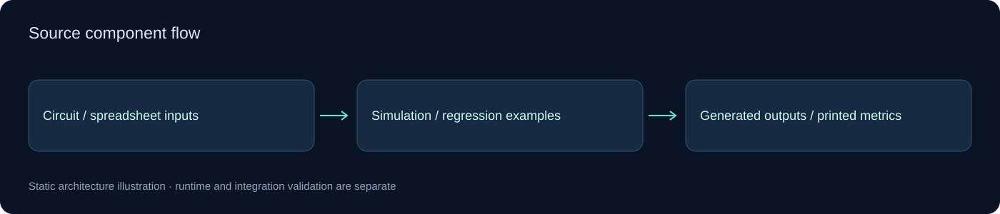

# Engineering Experiments

**Small engineering source studies: SKiDL/PySpice circuit netlist automation and a tabular regression example.**

[فارسی](docs/README.fa.md) · [Architecture](docs/ARCHITECTURE.md) · [Publication scope](docs/PUBLIC_EDITION.md)

## What the source contains

- A resistor-network example that combines netlist generation, a DC sweep and simple DRC-rule output.
- A spreadsheet-based linear regression example with held-out error metrics computed by the script.
- Separate folders keep the unrelated learning examples distinct.

## Start exploring

Separate Python environments are recommended for the two examples. Circuit automation needs SKiDL/PySpice, a compatible KiCad installation and ngspice. Regression needs the supplied dependencies and your own spreadsheet.

```bash
python -m pip install -r tabular-regression/requirements.txt
# Set TABULAR_DATASET to your own compatible spreadsheet before running:
python tabular-regression/regression_example.py
```

These commands are a setup reference, not a record of successful execution. No builds, tests, hardware sessions, provider requests or application runs were performed for this publication.

## Code entry points

- [`circuit-netlist/generate_netlist_and_simulate.py`](circuit-netlist/generate_netlist_and_simulate.py)
- [`tabular-regression/regression_example.py`](tabular-regression/regression_example.py)

## Architecture



See the [architecture guide](docs/ARCHITECTURE.md) for module boundaries and integration assumptions. Diagrams represent source structure; they are not screenshots or deployment evidence.

## Scope and current limits

These are educational experiments, not finished client products or validated engineering tools. No private spreadsheet, handwritten-data corpus, simulation artifact or third-party authored training script is included. Metric-printing code is retained, but no metrics were generated or claimed for this publication.

This compact public edition excludes previous Git history, real environment files, customer material, generated outputs and installed dependencies. Existing source/license notices are retained where present; no additional application license grant is invented.

## Work together

For a related workflow, custom application, integration or modernization project, [visit my GitHub profile](https://github.com/Ali771025) or [describe your project in an issue](https://github.com/Ali771025/engineering-experiments/issues/new). Scope and deployment requirements can be discussed before implementation.
