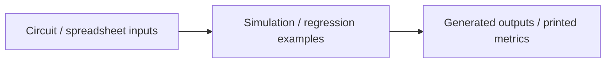

# Architecture — Engineering Experiments

[Back to the project](../README.md)

## Responsibilities

- **Circuit / spreadsheet inputs:** A resistor-network example that combines netlist generation, a DC sweep and simple DRC-rule output.
- **Simulation / regression examples:** A spreadsheet-based linear regression example with held-out error metrics computed by the script.
- **Generated outputs / printed metrics:** Separate folders keep the unrelated learning examples distinct.

## Source boundaries

These are educational experiments, not finished client products or validated engineering tools. No private spreadsheet, handwritten-data corpus, simulation artifact or third-party authored training script is included. Metric-printing code is retained, but no metrics were generated or claimed for this publication.

## Review entry points

- [`circuit-netlist/generate_netlist_and_simulate.py`](../circuit-netlist/generate_netlist_and_simulate.py)
- [`tabular-regression/regression_example.py`](../tabular-regression/regression_example.py)

## Verification boundary

This document is based on a static reading of the source. No new tests or builds were performed. Integration prerequisites, permission behavior, external dependencies and real data quality require their own acceptance work before production use.
